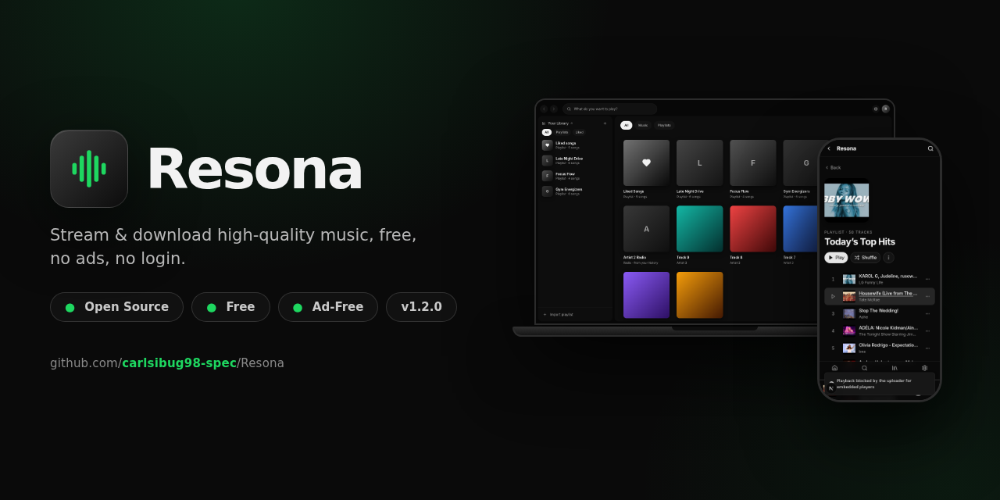

<div align="center">



# Resona

### Stream & download high-quality music, free, no ads, no login.


**[⬇️ Download (v1.3.0) HERE — it's free](https://github.com/carlsibug98-spec/Resona/releases/latest)** &nbsp;·&nbsp; **[🌐 Download site](https://carlsibug98-spec.github.io/Resona/)** &nbsp;·&nbsp; **[🐞 Report an issue](https://github.com/carlsibug98-spec/Resona/issues)**

</div>

---

## 📦 Downloads

| Platform | Status | Download | Details |
| --- | --- | --- | --- |
| 🪟 **Windows** 10 / 11 (64-bit) | ✅ **v1.3.0** | **[⬇️ Download EXE](https://github.com/carlsibug98-spec/Resona/releases/latest/download/Resona-Setup-1.3.0.exe)** | Installer · ~155 MB |
| 🍎 **macOS** (Apple Silicon & Intel) | 🔜 Soon | — | In testing |
| 🐧 **Linux** (AppImage / .deb) | 🔜 Soon | — | In testing |
| 📱 **iOS / Android** | 🧭 Planned | — | Mobile app in design |

> **All releases:** [github.com/carlsibug98-spec/Resona/releases](https://github.com/carlsibug98-spec/Resona/releases) · **Install guide:** [INSTALL-GUIDE.txt](https://github.com/carlsibug98-spec/Resona/releases/download/v1.3.0/INSTALL-GUIDE.txt)

## ✨ What's new in v1.3.0

- **🎨 Full UI redesign, built from the approved mockup** — sidebar + Your Library card, quick tiles, "Jump back in" / "Made for you" shelves, frosted-card play buttons, pill chips, karaoke lyrics panel and a full-screen now-playing view (art / lyrics / video / credits modes).
- **🎵 Real synced lyrics everywhere** — time-synced karaoke lyrics with a word-by-word fill, blur on distant lines, tap-to-seek and a *Sync to song* button when you scroll away. Powered by LRCLIB.
- **🌱 Starter content on first run** — the home looks alive from the first open: a few OPM picks, a "Late night" playlist, liked songs and history. All of it resolves into real, playable tracks and can be removed in **Settings → Starter content**.
- **⬇️ Working offline downloads** — every track row and the player bar show live download progress (ring → green check). Saved audio plays without a connection, and removing a download always asks first.
- **🔄 Update check on open** — Resona silently compares its version against the GitHub releases page once an hour and flags "Update available" in the account menu and in **Settings → Updates**.
- **☀️ Real light mode** — the whole canvas, not just the cards, now follows the Light / Dark / Auto theme.

## ✨ Features

- **🎧 Unlimited streaming** — millions of songs, albums and live sets via YouTube Music. Search, press play, done.
- **🎬 Synced lyrics** — time-synced, karaoke-style lyrics line by line, powered by lrclib.
- **📋 Playlists & Spotify import** — paste any public Spotify playlist URL; Resona search-matches every track into a local playlist.
- **⬇️ Offline downloads** — save songs locally through the built-in downloader and play them without a connection.
- **🏠 Spotify-style home** — quick tiles, made-for-you shelves, two-panel sidebar and a full-width player bar.
- **👤 No account needed** — install and play. No sign-up, no email, no tracking. Your library stays on your machine.
- **💚 100% free & open source** — MIT licensed. No ads, no premium tier, forever.

## 🖼️ Screenshots

| Home | Synced lyrics | Playlists |
| --- | --- | --- |
|  |  |  |

## 🚀 Install on Windows

1. **Download** `Resona-Setup-1.3.0.exe` from the [releases page](https://github.com/carlsibug98-spec/Resona/releases/latest) (~155 MB)
2. **If Windows SmartScreen shows a warning** — this is expected and safe. Resona's installer is *not code-signed* (a signing certificate costs ~$100+/yr), so Windows warns about every app it hasn't seen before. It does **not** mean a virus was found. To run the installer:
   - Click **More info** → **Run anyway**. That's it.
   - Or, if the download finished already: right-click the `.exe` → **Properties** → tick **Unblock** → OK, then double-click it.
   - After install, launch from the desktop shortcut. The app itself doesn't need unblocking again unless SmartScreen has never seen it run before.
3. Follow the wizard — a desktop shortcut is created automatically. Play music.

**Verify (SHA-256):** compare against the checksum published in each release's notes:

```
Get-FileHash .\Resona-Setup-1.3.0.exe   # in PowerShell
```

> Signed builds are on the roadmap — until then the two steps above are the only friction.

## 🛠️ Build from source

```bash
git clone https://github.com/carlsibug98-spec/Resona.git
cd Resona
bun install          # or npm install

# Web app
bun run dev          # http://localhost:3000
bun run build        # Next.js production build (standalone output)
bun run start        # serve the production build

# Windows desktop installer
node scripts/stage-desktop.js
cd desktop && npx electron-builder --win nsis
# → desktop/dist/Resona-Setup-<version>.exe
```

## 🧭 How things work

| Topic | Details |
| --- | --- |
| **Playback** | Resona tries three sources in order: an offline copy saved in IndexedDB → a direct audio stream through a same-origin proxy (Piped/Invidious resolvers, configurable in Settings) → the official YouTube embedded player. |
| **Downloads** | The same resolver pipeline fetches the audio, shows a progress ring in every row, and stores it in IndexedDB. Downloaded tracks play with zero network. Removing one asks for confirmation first. |
| **Lyrics** | LRCLIB's synced LRC lines drive the karaoke panel; unsynced text and "no lyrics" states are handled honestly. |
| **Starter content** | The mockup's OPM demo tracks are seeded on first run and resolved through real search — no invented video ids. Remove everything in Settings → Starter content; anything you added yourself is untouched. |
| **Updates** | Once an hour (and on demand via *Check now*) Resona compares its version to `carlsibug98-spec/Resona/releases/latest` on GitHub and surfaces an "Update available" link. Nothing is installed automatically. |
| **Backups** | Likes, playlists and history export as JSON (account menu → *Export now*). Restoring offers merge or replace per section. Downloaded audio stays on its device by design. |

## 🧱 Tech stack

| Layer | Tech |
| --- | --- |
| UI | Next.js (App Router) · React · Zustand · mockup-derived design system |
| Music data | YouTube Music (innertube) · kworb charts (81 regions) |
| Playback | HTML5 audio / YouTube embedded player · resolver-proxied direct streams |
| Lyrics | lrclib.net (time-synced) |
| Desktop | Electron 45 + electron-builder (NSIS) |
| License | MIT |

## ⚠️ Disclaimer

Resona is a media interface that streams publicly available content via YouTube Music's public catalog. It does **not** host, store, or distribute any music files. All content remains the property of its respective copyright holders. Users are responsible for complying with the laws and terms of service in their own jurisdiction. Resona is **not affiliated with YouTube, Google or Spotify**.

## 📄 License

Released under the [MIT License](LICENSE) — free to use, study, modify and share.
