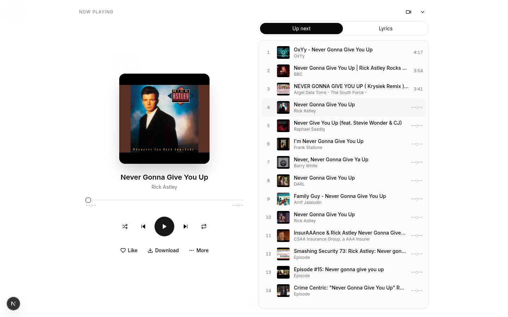

<div align="center">


# Resona

### Stream & download high-quality music, free, no ads, no login.


**[⬇️ Download (v1.7.3) HERE — it's free](https://github.com/carlsibug98-spec/Resona/releases/latest)** &nbsp;·&nbsp; **[🌐 Download site](https://carlsibug98-spec.github.io/Resona/)** &nbsp;·&nbsp; **[🐞 Report an issue](https://github.com/carlsibug98-spec/Resona/issues)**

</div>

---

<!-- ⚠️ RELEASE CHECKLIST: every release/build must bump every version
     string in this file — hero line, downloads table, What's new section,
     install commands (see PROJECT-NOTES.md → Release checklist). -->

## 📦 Downloads

| Platform | Status | Download | Details |
| --- | --- | --- | --- |
| 🪟 **Windows** 10 / 11 (64-bit) | ✅ **v1.7.3** | **[⬇️ Download installer](https://github.com/carlsibug98-spec/Resona/releases/latest/download/Resona-Setup-1.7.3.exe)** | Run the wizard → desktop shortcut · ~154 MB · later versions install themselves at launch |
| 🍎 **macOS** (Apple Silicon) | ✅ **v1.7.3** | **[⬇️ Download DMG](https://github.com/carlsibug98-spec/Resona/releases/latest/download/Resona-1.7.3-arm64.dmg)** | Open → drag to Applications · right-click → Open the first time (unsigned) |
| 🍎 **macOS** (Intel) | ✅ **v1.7.3** | **[⬇️ Download DMG](https://github.com/carlsibug98-spec/Resona/releases/latest/download/Resona-1.7.3-x64.dmg)** | Same steps as Apple Silicon |
| 🐧 **Linux** (AppImage / .deb, x64) | ✅ **v1.7.3** | **[⬇️ AppImage](https://github.com/carlsibug98-spec/Resona/releases/latest/download/Resona-1.7.3.AppImage)** · **[⬇️ .deb](https://github.com/carlsibug98-spec/Resona/releases/latest/download/Resona-1.7.3.deb)** | `chmod +x` the AppImage, or `sudo apt install ./Resona-1.7.3.deb` |
| 📱 **iOS / Android** | 🧭 Planned | — | Mobile app in design |

> **All releases:** [github.com/carlsibug98-spec/Resona/releases](https://github.com/carlsibug98-spec/Resona/releases) · **Install guide:** [INSTALL-GUIDE.txt](https://github.com/carlsibug98-spec/Resona/releases/latest/download/INSTALL-GUIDE.txt) · **SHA-256:** `SHA256SUMS.txt` in every release

## ✨ What's new in v1.7.3

- **⏸️ A track that fails to start STAYS on screen** — v1.7.1 auto-advanced the queue past failing tracks, which both hid the real problem and moved to other songs without being asked. Now a failed track sits still with its **Retry / Skip / Dismiss** banner until *you* act; the queue never advances on its own.
- **🛑 The root cause of "some tracks never play" — found by comparison**: Musify (4.4k★) walks InnerTube clients **one at a time**; OpenSpot streams from JioSaavn; Resona v1.7.0–1.7.3 fired **four /player POSTs in parallel per track** — and live repro showed YouTube answering that burst with its bot gate ("Sign in to confirm you're not a bot") for minutes. The gate even *flaps per request* (one track gated, the next fine seconds later), which is exactly the "some tracks" texture. v1.7.3 adopts Musify's discipline: a **sequential client ladder** (ANDROID_VR → sdkless ANDROID → TVHTML5 Cobalt), one POST per track on the happy path, and a full 10-minute InnerTube back-off only when **every** client comes back gated — after which yt-dlp and the instance fleet take over.
- **🔑 Streams are fetched with the identity that minted them** — Musify's bundled youtube_explode documents that googlevideo ties app-client URLs to the requesting client's User-Agent and 403s a mismatch "even for a perfectly valid, PO-Token-exempt stream" — the #1 cause of silent 403s, and a browser `<audio>` element always sends Chrome's UA. Resona now verifies each URL **with the minting client's UA** and plays InnerTube streams through its own byte proxy presenting that same UA (the proxy is how a desktop app honors Musify's "headers must match" rule).
- **🧹 Dead clients replaced** — ANDROID_MUSIC (rejected 400, deprecated upstream) and TVHTML5_SIMPLY_EMBEDDED_PLAYER ("no longer supported in this application") are out; **TVHTML5 Cobalt 7.20260707.07.00** (Musify's working TV client) is in, and it also answers for embed-restricted videos.
- **🩺 Honest diagnostics** — the per-video gate now distinguishes the bot gate from the age gate, and the backoff after a flapping failure is 60 s, so a track that drew a bad roll gets a fresh one on retry instead of a 10-minute ban.

## ✨ What's new in v1.7.3

- **🔍 Every stream URL is now proven playable before it reaches you** — v1.7.0's provider races let the fastest *answer* win and cached it for 30 minutes, but answering isn't serving: a Piped instance or an InnerTube client can hand out a URL that 403s the moment playback starts. That's why **some tracks went silent after v1.7.0 while they played fine on v1.6.x**. Now every candidate URL — InnerTube, yt-dlp, Piped, Invidious — passes a 1-byte range check before it can win the race, be cached, or pin an instance; a dead answer loses and the next provider takes over. The same guarantee Musify and OpenSpot get by resolving in the process that plays.
- **⚡ No cost to speed** — the check adds ~100–300 ms only on first resolve; hover-prefetch and next-track warming hide it entirely.
- **🍎🐧 macOS and Linux builds now ship with every release** (unsigned DMGs for Apple Silicon + Intel, AppImage + .deb for x64).

## ✨ What's new in v1.7.1

- **🖱️ "Click play and it pauses again" — fixed**: after a track failed to start, the play button flipped straight back to paused; the engine now reloads the track for real on every press.
- **⏭️ The queue never gives up** — a failed track auto-advances, and one-song queues (Play on an artist) extend with the song's radio instead of dead-ending.
- **📣 Failures are fast and honest** — an unplayable track fails in ~5 s (was 30+) with **Retry / Skip / Run diagnostics**; embed-refused videos are remembered and skipped instantly for 10 minutes.

## ✨ What's new in v1.7.0

- **🔓 The playback hang is fixed** — the resolver no longer serialises slow providers: InnerTube (four clients raced in parallel, ~150–400 ms, two of them answering even for embed-blocked videos) runs first, then yt-dlp and the whole Piped/Invidious fleet race together.
- **🩺 Settings → Playback diagnostics** — every provider is probed independently with timings and a copyable report, so "why won't anything play" has a real answer.
- **🎨 A full UI/UX pass** — streamlining across the player, library and settings.

## ✨ What's new in v1.6.5

- **🛰️ Never-empty shelves** — trending no longer goes blank when kworb's chart site is down: Resona falls back to YouTube Charts through the same keyless pipeline (real, playable tracks), a bad chart pass is never cached for hours, and a cold server warms the home catalog at boot so the first visit doesn't stare at "Loading…".
- **🧭 Top-bar navigation, Spotify-style** — a green Home pill up top; the sidebar nav card is gone (Home & Search in the top bar, Settings & Trending in the profile menu, Trending still on the home shelf).
- **🎵 Sidebar lyrics match fullscreen** — whole-line highlight everywhere; the word-by-word gradient sweep is gone (click a line to seek — still there).
- **⌨️ Taskbar media controls always work** — prev / play-pause / next are pushed on app start, window focus and every playback change, and `mediaSession.playbackState` keeps OS overlays and media keys honest.
- **🗄️ A real database under the app** — likes, playlists, history and the server cache now live in SQLite (libsql + Drizzle): a restart no longer throws away resolved streams and searches.
- **🖱️ Touch & a11y fixes** — row actions always visible on touch devices, alt text on covers, ≥3:1 contrast in light theme, reduced-motion respected, search shows a result count with Load more (the ten v1.6.4 audit findings, shipped).

## ✨ What's new in v1.6.4

- **🎤 Lyrics you can read again** — the lyrics panel no longer strands you: auto-follow snaps straight to the active line when you open it or seek, glides line-to-line while the song plays, and — like Spotify — resumes on its own a few seconds after you scroll manually (the Sync button is still there for an instant re-anchor; click any line to jump to it).
- **📋 A lyrics restyle** — the album art folds into a compact header row so the words own the whole panel, upcoming lines are bright enough to actually read, and past lines fade with distance instead of blurring away.
- **🚫 No more parked-scrollbar stripe** — the thick vertical line that lived down the right side of every list was the scrollbar lighting up on hover; it now appears only while you scroll and fades out after.

## ✨ What's new in v1.6.3

- **🖼️ One mark everywhere** — the taskbar / Dock / start-menu icon is now the **five-bar Resona mark** the header and website already use, in paper cream on a warm-dark squircle. It replaces the old v1.4.0 broadcast-waves design.
- **🔎 Crisp at every size** — the Windows icon (16→256 px) is rendered natively per size instead of downscaled from one bitmap; tiny taskbar sizes get an optically heavier stroke so the bars stay readable.
- **🌐 Favicon** — the web app gets the same mark as `/icon.svg`.

## ✨ What's new in v1.6.2

- **🎛️ Taskbar playback controls** — hover Resona's taskbar icon on Windows and the thumbnail preview carries **Previous / Play / Next** buttons, Spotify-style (macOS: the same three in the dock menu). Buttons dim honestly at dead-ends.
- **🪟 A window that feels native** — frameless window with the app's own header (min / max / close, drag anywhere), a collapsible library rail, a docked resizable queue with Queue / Recently played tabs, overlay scrollbars and tooltips.
- **✅ Honest onboarding + phone fixes** — checklist steps complete when you actually do the thing, the popover can't be clipped, and the phone layout got several repairs.

## ✨ What's new in v1.6.1

- **⚡ Instant starts** — the stream resolves in the background while you hover or press a row (450 ms intent), the next queue track resolves ahead, and the server merges duplicate resolves — the first click on a song no longer waits for yt-dlp / Piped fallbacks (up to ~25 s before).
- **👆 Click anywhere to play** — the whole track row is clickable, not just the small hover-revealed play button; the play / like / save / ⋯ buttons keep their own actions.

## ✨ What's new in v1.6.0

- **🔄 The app updates itself** — on launch Resona silently downloads a newer release while the splash screen shows live progress (10-second cap), installs it and starts the new build. v1.6.0 was the last manual install; every later version arrives on its own.
- **✅ Getting-started checklist** — a progress ring around the profile avatar fills as you finish six steps (search, make a playlist, like a song, start a radio, download for offline, import your music); hovering the avatar shows the checklist popover.
- **📌 Queue drawer** — the queue button opens a Now playing / Next up panel; long-press a row (350 ms) and drag to reorder, tap to jump, Esc closes.
- **🖼️ Real artist artwork** — the Popular artists shelf shows real YouTube Music photos (the 1.5.0 loader shipped broken and is fixed), card play buttons are centred on the cover again, the snackbar is a proper bottom bar with actions, and the sidebar wears the brand wordmark.

## ✨ What's new in v1.5.0

- **🏡 A home that welcomes you** — first run opens on "Welcome to Resona" with a **Getting started** carousel (search, playlists, likes, radio, downloads, import) on top; no quick tiles until you actually have something. First like, playlist, download or import switches to the full home.
- **🌍 Global shelves** — **Popular artists** (round covers, real artist pages), **Popular albums and singles**, and **New releases** (green NEW badges) — single-row shelves with arrows, built live from the worldwide trending chart and playable in one tap.
- **🪟 New download site** — the download page was redesigned (paper palette, equalizer hero, per-platform buttons, live SHA-256 checksum) and now updates its own version labels, sizes and links from the GitHub releases API.

## ✨ What's new in v1.4.0

- **🎬 Real music videos** — the Video button in full-screen now playing plays the song's actual video inside the app, perfectly docked into the mockup's video panel. Leaving video mode returns to audio at the exact same position.
- **🎤 Real credits** — the full-screen Credits card is filled from MusicBrainz: writers, producers, performers, album and year (with an honest fallback for unknown tracks).
- **📡 Radio** — *Start radio* in any track menu queues the YouTube Music mix for that song (up to 40 tracks), and **autoplay radio** keeps the music going when your queue runs out (toggle in Settings → Playback).
- **🍎🐧 macOS & Linux builds** — `.dmg` for Apple Silicon and Intel, `.AppImage` and `.deb` for Linux, built by CI alongside the Windows installer, with per-platform yt-dlp bundled.
- **✍️ Code-signing pipeline** — the build signs itself the moment you add signing secrets; see [SIGNING.md](SIGNING.md) for the free (SignPath) and cheap (Certum ~€25/49) routes to kill the SmartScreen warning for good.

## ✨ What's new in v1.3.0

- **🎨 Full UI redesign, built from the approved mockup** — sidebar + Your Library card, quick tiles, "Jump back in" / "Made for you" shelves, frosted-card play buttons, pill chips, karaoke lyrics panel and a full-screen now-playing view (art / lyrics / video / credits modes).
- **🎵 Real synced lyrics everywhere** — time-synced karaoke lyrics with a word-by-word fill, blur on distant lines, tap-to-seek and a *Sync to song* button when you scroll away. Powered by LRCLIB.
- **🌱 Starter content on first run** — the home looks alive from the first open: a few OPM picks, a "Late night" playlist, liked songs and history. All of it resolves into real, playable tracks and can be removed in **Settings → Starter content**.
- **⬇️ Working offline downloads** — every track row and the player bar show live download progress (ring → green check). Saved audio plays without a connection, and removing a download always asks first.
- **🔄 Update check on open** — Resona silently compares its version against the GitHub releases page once an hour and flags "Update available" in the account menu and in **Settings → Updates**.
- **☀️ Real light mode** — the whole canvas, not just the cards, now follows the Light / Dark / Auto theme.

## ✨ Features

- **🎧 Unlimited streaming** — millions of songs, albums and live sets via YouTube Music. Search, press play, done.
- **🎬 Real music videos & synced lyrics** — watch the actual video in full-screen mode; karaoke-style lyrics powered by LRCLIB.
- **📡 Song radio & autoplay** — endless similar songs from any track.
- **📋 Playlists & Spotify import** — paste any public Spotify playlist URL; Resona search-matches every track into a local playlist.
- **⬇️ Offline downloads** — save songs locally through the built-in downloader and play them without a connection.
- **🏠 Spotify-style home** — quick tiles, made-for-you shelves, two-panel sidebar and a full-width player bar.
- **👤 No account needed** — install and play. No sign-up, no email, no tracking. Your library stays on your machine.
- **💚 100% free & open source** — MIT licensed. No ads, no premium tier, forever.

## 🖼️ Screenshots

| Home | Synced lyrics | Playlists |
| --- | --- | --- |
|  |  |  |

## 🚀 Install on Windows

1. **Download** `Resona-Setup-1.7.3.exe` from the [releases page](https://github.com/carlsibug98-spec/Resona/releases/latest) (~154 MB) and run the wizard — per-user install (no admin needed), desktop shortcut created. Install over an older copy to update; your library carries over. **From v1.6.0 on, later versions install themselves at launch** — this is the last manual install you need.
2. **If Windows SmartScreen shows a warning** — this is expected and safe. Resona is *not code-signed* (a signing certificate costs ~$100+/yr), so Windows warns about every app it hasn't seen before. It does **not** mean a virus was found. To run it:
   - Click **More info** → **Run anyway**. That's it.
   - Or, if the download finished already: right-click `Resona-Setup-1.7.3.exe` → **Properties** → tick **Unblock** → OK, then double-click it.
3. Play music. Your library lives in `%APPDATA%/resona`.

**Verify (SHA-256):** compare against `SHA256SUMS.txt` published with every release:

```
Get-FileHash .\Resona-Setup-1.7.3.exe   # in PowerShell
```

**macOS**: the `.dmg` is unsigned — right-click Resona → **Open** the first time (or `xattr -d com.apple.quarantine /Applications/Resona.app`). Apple Silicon machines take `Resona-1.7.3-arm64.dmg`, Intel takes `Resona-1.7.3-x64.dmg`.  
**Linux**: `chmod +x Resona-1.7.3.AppImage && ./Resona-1.7.3.AppImage`, or install the `.deb` with `sudo apt install ./Resona-1.7.3.deb`.

> Signed builds are on the roadmap — until then the two steps above are the only friction.

## 🛠️ Build from source

```bash
git clone https://github.com/carlsibug98-spec/Resona.git
cd Resona
bun install          # or npm install

# Web app
bun run dev          # http://localhost:3000
bun run build        # Next.js production build (standalone output)
bun run start        # serve the production build

# Windows desktop installer
node scripts/stage-desktop.js
cd desktop && npx electron-builder --win nsis
# → desktop/dist/Resona-Setup-<version>.exe
```

## 🧭 How things work

| Topic | Details |
| --- | --- |
| **Playback** | Resona tries three sources in order: an offline copy saved in IndexedDB → a direct audio stream through a same-origin proxy → the official YouTube embedded player. Streams resolve through InnerTube first — four clients raced in parallel (~150–400 ms, including two that answer even for embed-blocked videos) — then yt-dlp and a fleet of Piped/Invidious instances raced together, with live defaults, runtime discovery from the official registries every 6 h and last-working-first ordering (extra instances configurable in Settings). **Every candidate URL is verified to actually serve bytes (a 1-byte range probe) before it can win a race or be cached** — a provider answering with a URL that 403s on fetch loses to the next one instead of going silent. A dead cached URL re-resolves automatically. Resolution starts while you hover a row and the next queue track resolves ahead; results are cached 30 minutes **in SQLite, so they survive restarts** — every start after the first is instant. **Settings → Diagnostics** runs every provider with timings and produces a copyable report. |
| **Downloads** | The same resolver pipeline fetches the audio, shows a progress ring in every row, and stores it in IndexedDB. Downloaded tracks play with zero network. Removing one asks for confirmation first. |
| **Lyrics** | LRCLIB's synced LRC lines drive the karaoke panel; unsynced text and "no lyrics" states are handled honestly. |
| **Library** | Likes, playlists and history live in localStorage *and* in the server's SQLite database (mirrored on every change, merged at boot) — a wiped browser profile no longer loses the library, and history keeps up to 500 entries instead of 60. |
| **Database** | SQLite via libsql + Drizzle ORM: the persistent TTL cache (`kv`) and the library mirror (`likes`, `playlists`, `playlist_tracks`, `history`). One file at `RESONA_DB_PATH` — the OS user-data dir on desktop (`<userData>/data/resona.db`), `./resona.db` in dev. If the file can't be opened the app degrades to memory-only and still runs. |
| **Home & onboarding** | First run opens the Welcome home (Getting started carousel, no quick tiles). The first like / playlist / download / import graduates you to the full home. Upgrades from earlier versions keep the full home. |
| **Global shelves** | Popular artists / Popular albums and singles / New releases come from the worldwide trending chart via `/api/catalog` (6 h server cache, 30 min per-track resolve cache shared with the Trending view). Artist cards open real artist pages. |
| **Your library only** | No demo content: installs start with an empty library, and v1.6.9 removes the starter songs older versions seeded on first run (matched by title+artist, so anything you added yourself is untouched — a playlist you rebuilt with your own songs stays). |
| **Updates** | On launch the desktop app checks this repo's releases; a newer build is downloaded while the splash screen shows progress, then installed and started (10-second cap — on slow connections the app opens and the update finishes on the next quit). The hourly in-app check remains as a fallback and surfaces "Update available" in the account menu and Settings → Updates. |
| **Backups** | Likes, playlists and history export as JSON (account menu → *Export now*). Restoring offers merge or replace per section. Downloaded audio stays on its device by design. |

## 🧱 Tech stack

| Layer | Tech |
| --- | --- |
| UI | Next.js (App Router) · React · Zustand · mockup-derived design system |
| Music data | YouTube Music (innertube) · kworb charts (81 regions) |
| Storage | SQLite (libsql + Drizzle ORM) for cache + library · IndexedDB for audio |
| Playback | HTML5 audio / YouTube embedded player · resolver-proxied direct streams |
| Lyrics | lrclib.net (time-synced) |
| Desktop | Electron 45 + electron-builder (NSIS) |
| License | MIT |

## ⚠️ Disclaimer

Resona is a media interface that streams publicly available content via YouTube Music's public catalog. It does **not** host, store, or distribute any music files. All content remains the property of its respective copyright holders. Users are responsible for complying with the laws and terms of service in their own jurisdiction. Resona is **not affiliated with YouTube, Google or Spotify**.

## 📄 License

Released under the [MIT License](LICENSE) — free to use, study, modify and share.
