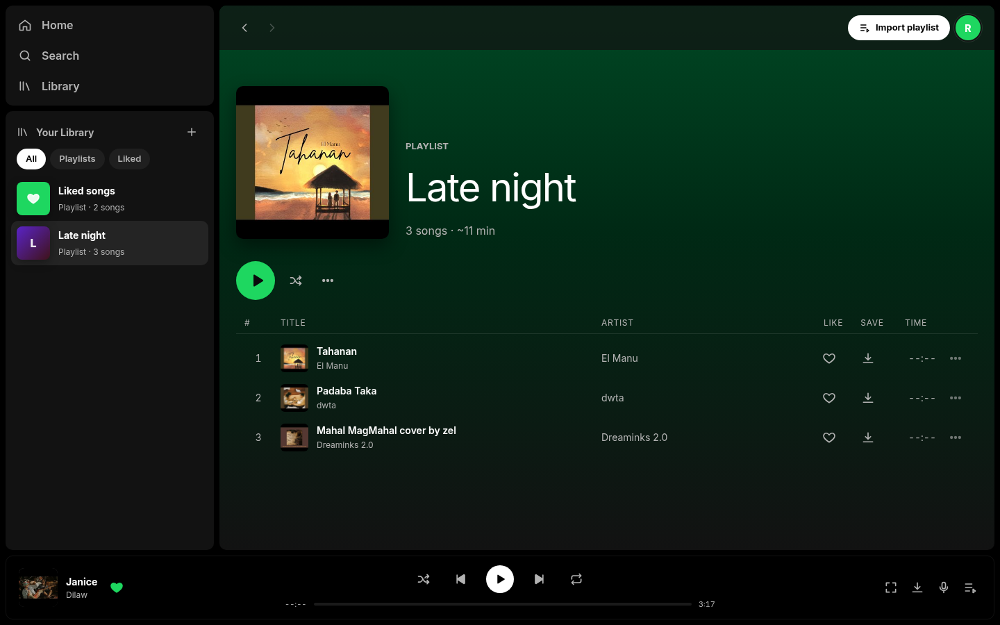

<div align="center">


# Resona

### Stream & download high-quality music, free, no ads, no login.


**[⬇️ Download (v1.2.0) HERE — it's free](https://github.com/carlsibug98-spec/Resona/releases/latest)** &nbsp;·&nbsp; **[🌐 Download site](https://carlsibug98-spec.github.io/Resona/)** &nbsp;·&nbsp; **[🐞 Report an issue](https://github.com/carlsibug98-spec/Resona/issues)**

</div>

---

## 📦 Downloads

| Platform | Status | Download | Details |
| --- | --- | --- | --- |
| 🪟 **Windows** 10 / 11 (64-bit) | ✅ **v1.2.0** | **[⬇️ Download EXE](https://github.com/carlsibug98-spec/Resona/releases/latest/download/Resona-Setup-1.2.0.exe)** | Installer · ~155 MB |
| 🍎 **macOS** (Apple Silicon & Intel) | 🔜 Soon | — | In testing |
| 🐧 **Linux** (AppImage / .deb) | 🔜 Soon | — | In testing |
| 📱 **iOS / Android** | 🧭 Planned | — | Mobile app in design |

> **All releases:** [github.com/carlsibug98-spec/Resona/releases](https://github.com/carlsibug98-spec/Resona/releases) · **Install guide:** [INSTALL-GUIDE.txt](https://github.com/carlsibug98-spec/Resona/releases/download/v1.2.0/INSTALL-GUIDE.txt)

## ✨ Features

- **🎧 Unlimited streaming** — millions of songs, albums and live sets via YouTube Music. Search, press play, done.
- **🎬 Synced lyrics** — time-synced, karaoke-style lyrics line by line, powered by lrclib.
- **📋 Playlists & Spotify import** — paste any public Spotify playlist URL; Resona search-matches every track into a local playlist.
- **⬇️ Offline downloads** — save songs locally through the built-in downloader and play them without a connection.
- **🏠 Spotify-style home** — quick tiles, made-for-you shelves, two-panel sidebar and a full-width player bar.
- **👤 No account needed** — install and play. No sign-up, no email, no tracking. Your library stays on your machine.
- **💚 100% free & open source** — MIT licensed. No ads, no premium tier, forever.

## 🖼️ Screenshots

| Home | Synced lyrics | Playlists |
| --- | --- | --- |
|  |  |  |

## 🚀 Install on Windows

1. **Download** `Resona-Setup-1.2.0.exe` from the [releases page](https://github.com/carlsibug98-spec/Resona/releases/latest) (~155 MB)
2. If SmartScreen shows a warning, click **More info → Run anyway** (the installer isn't code-signed yet)
3. Follow the wizard — a desktop shortcut is created automatically. Play music.

**Verify (SHA-256):**
```
90e0a9327578e05147d6f9b437369c67553c4bdf00febf0a9ce17066f1682e84
```

## 🛠️ Build from source

```bash
git clone https://github.com/carlsibug98-spec/Resona.git
cd Resona
bun install          # or npm install

# Web app
bun run build        # Next.js production build (standalone output)
bun run start        # serve at http://localhost:3000

# Windows desktop installer
node scripts/stage-desktop.js
cd desktop && npx electron-builder --win nsis
# → desktop/dist/Resona-Setup-<version>.exe
```

## 🧱 Tech stack

| Layer | Tech |
| --- | --- |
| UI | Next.js (App Router) · React · Zustand · Tailwind-style CSS |
| Music data | YouTube Music (innertube) · kworb charts (81 regions) |
| Playback | HTML5 audio / YouTube embedded player · yt-dlp direct streams |
| Lyrics | lrclib.net (time-synced) |
| Desktop | Electron 45 + electron-builder (NSIS) |
| License | MIT |

## ⚠️ Disclaimer

Resona is a media interface that streams publicly available content via YouTube Music's public catalog. It does **not** host, store, or distribute any music files. All content remains the property of its respective copyright holders. Users are responsible for complying with the laws and terms of service in their own jurisdiction. Resona is **not affiliated with YouTube, Google or Spotify**.

## 📄 License

Released under the [MIT License](LICENSE) — free to use, study, modify and share.
