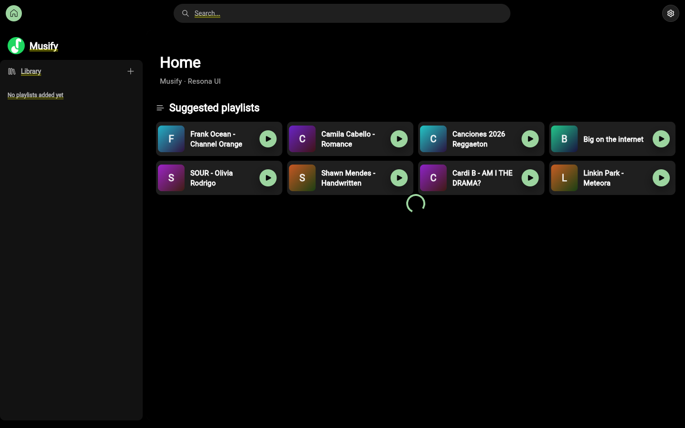
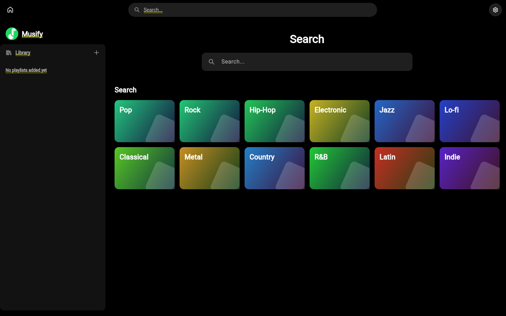
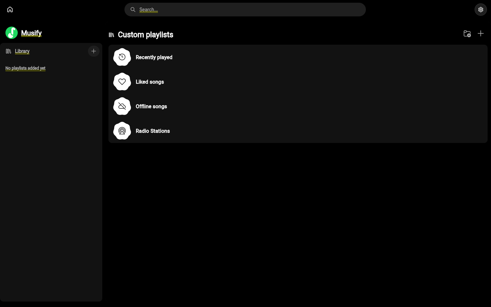
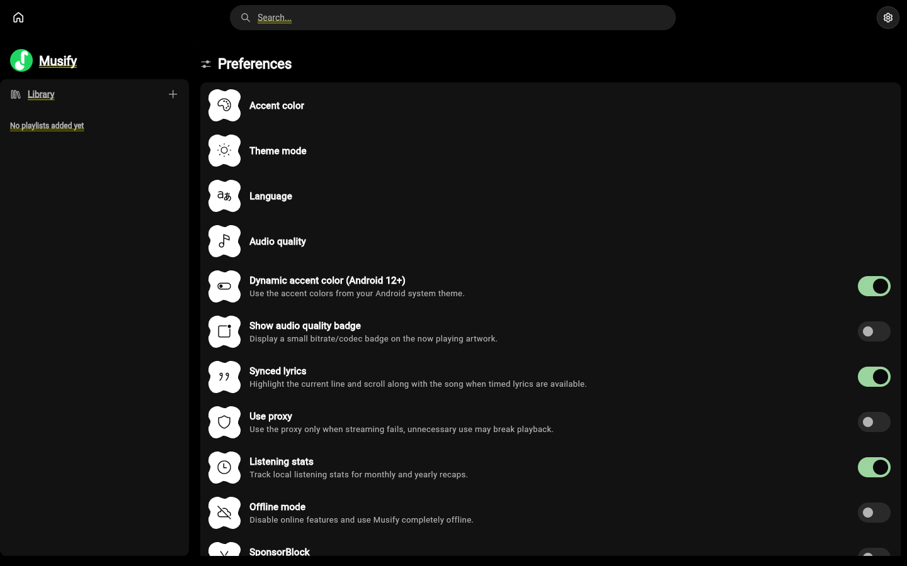

# Musify — Resona UI edition

This folder is [gokadzev/Musify](https://github.com/gokadzev/Musify)
(upstream `v10.7.1`, GPL-3.0) with **Resona's desktop UI design implemented
on top of it**. Every feature of Musify still works — YouTube Music
streaming, offline downloads, playlists, local sync, listening stats,
equalizer — the presentation layer was rebuilt to match
[Resona](https://github.com/carlsibug98-spec/Resona). Dark is the source of
truth and light is a full sibling variant; the shell, player bar and
now-playing panel also respond to window width the way Resona's responsive
mockup does.

## What changed vs upstream

Ported from Resona's `globals.css` design system (black background,
`#121212` surfaces, `#1F1F1F` elevation, white 10% hairlines, `#B3B3B3`
muted text, `#1ED760` brand green, 10px radius):

## Screenshots

Captured from a `flutter build web --release` run at 1440×900 (dark theme):

| Home | Search |
| :---: | :---: |
|  |  |

| Library | Preferences |
| :---: | :---: |
|  |  |

The sandbox the screenshots were taken in blocks the YouTube Music API, so
recommended-song rows and playlist contents show their loading states;
with a normal network they fill in normally.

| Area | File(s) | Change |
| --- | --- | --- |
| Design tokens | `lib/theme/resona_ui.dart` (new) | Resona palette, `hueFor()` stable per-item hue, `plGrad`/`grad` gradients, npp glow colors |
| Theme | `lib/theme/app_themes.dart` | Full Resona re-theme: surfaces, pill buttons, chips, dialogs, menus, inputs, tooltips, snackbars |
| Accent | `lib/services/settings_manager.dart`, `lib/theme/app_colors.dart` | Default accent is now Resona Green `#1ED760` |
| Shell | `lib/screens/bottom_navigation_page.dart` | Resona `.app` grid: 56px top bar (home disc + centered search pill + settings avatar), 300px sidebar (brand row + "Your Library" card with chips & rows, collapses < 760px), content in a rounded `#121212` panel, player bar docked at the bottom |
| Player bar | `lib/widgets/mini_player.dart` | Resona `.player`: 80px, 3 zones — track info / transport + seek line / like + volume (wide screens) |
| Track rows | `lib/widgets/song_bar.dart` | Resona `.trow`: transparent rows, 44px/6px covers, compact padding |
| Covers | `lib/widgets/playlist_cube.dart` | Resona `.cov`: deep drop shadow + bottom wash + frosted label |
| Search | `lib/widgets/custom_search_bar.dart`, `lib/screens/search_page.dart` | `.sbox` focus ring, genre browse grid (`.genre`) with stable hue gradients |
| Home | `lib/screens/home_page.dart` | Hero heading + `.qtile` quick tiles grid on wide screens |
| Playlist hero | `lib/widgets/playlist_page/playlist_sliver_app_bar.dart`, `playlist_header.dart` | `.phero`: bottom-left 180px cover, huge `w800 -0.03em` title |
| Now playing | `lib/screens/now_playing_page.dart` | `.npp-bg`: layered radial hue glows over near-black with dark scrim |
| Light theme | `lib/theme/app_themes.dart`, `lib/theme/resona_ui.dart`, `lib/screens/now_playing_page.dart` | Full light variant of the same system: `#F3F3F5` bg, white surfaces, ink splash + soft popup shadows, pastel radial glows for now-playing, theme-aware chrome |
| Responsive player bar | `lib/widgets/mini_player.dart` | 3 width tiers — full 3-zone grid ≥900px, center stack 640–899px, compact row <640px (artwork + title, prev/play/next, like, 2px progress hairline on the top edge) so phone widths no longer overflow |
| Sidebar collapse | `lib/screens/bottom_navigation_page.dart` | Collapses automatically under 760px (Resona breakpoint) and can also be pinned collapsed from the library header; width animates (220ms) for smooth window resizes |
| Misc | section headers (`.section-h`), chips (`.chip`), announcements (`.nudge`), bar radius constants | Restyled to Resona tokens |
| Shell paint | `lib/screens/bottom_navigation_page.dart` | Shell now paints the app background itself so no platform-default white bleeds through around the cards; brand row uses a green brand chip (the bundled wordmark glyph is white) |
| Web runtime | `lib/main.dart`, `lib/utilities/platform_utils.dart`, `lib/services/linux_media_controls.dart` | Platform guards (`kIsWeb`) for `Platform.*` getters, `Hive.initFlutter()` IndexedDB storage, `AudioService.init` on web, and a JS-safe position clamp sentinel — the app boots on Flutter Web |

## Verify locally

```bash
cd musify-app
flutter pub get
flutter analyze   # clean
flutter test      # 222 passing; the 3 network/multicast tests need real internet
flutter run       # android / windows / linux
```

Web also works now — the runtime guards from the table above are part of
this repo, so the only remaining upstream web blocker is the Linux MPRIS
position clamp, fixed here too:

```bash
flutter create . --platforms web   # once, to add the web/ scaffold
flutter run -d chrome
```

## License

GPL-3.0, same as upstream Musify and Resona. All upstream copyright notices
are retained in every modified file. © Valeri Gokadze for the original
Musify code; UI redesign ported from Resona.
